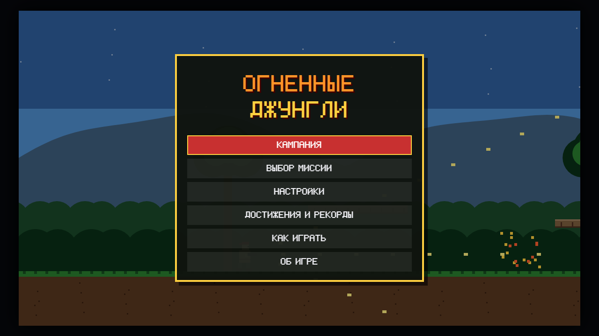
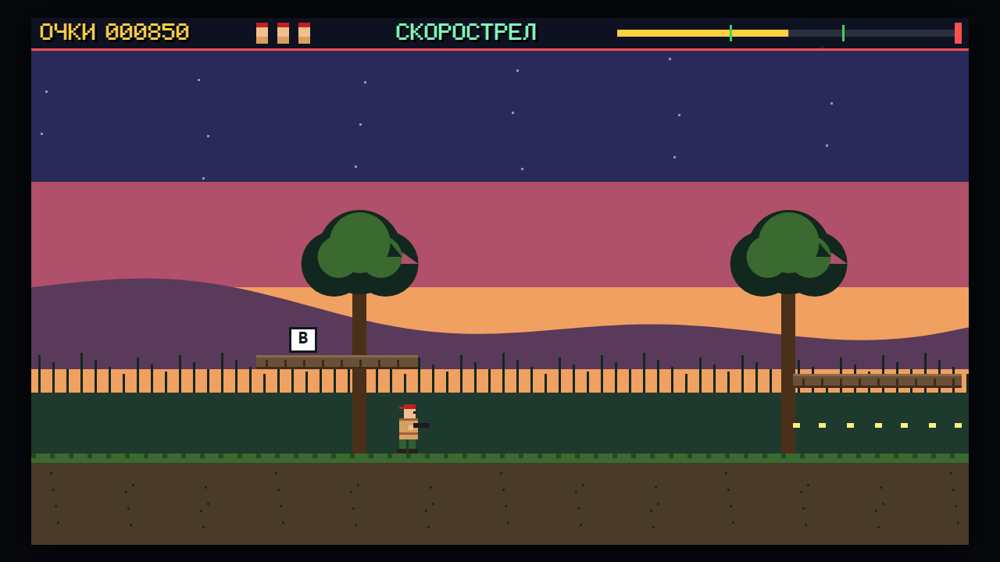
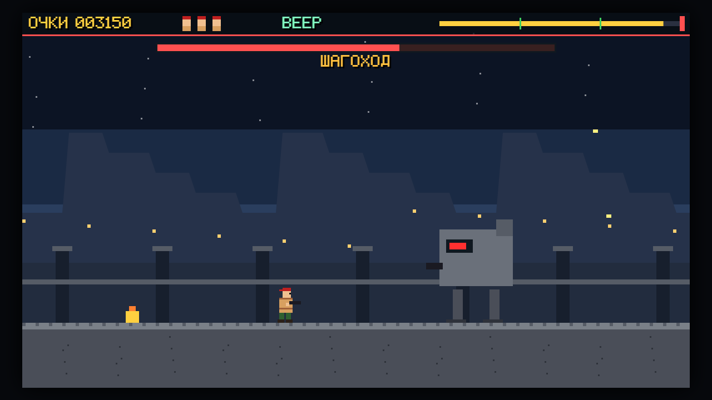

<div align="center">

# HotJungle - Огненные джунгли

**Огненные джунгли - аркада-стрелялка на одной HTML-странице: пять миссий через джунгли, в конце каждой - босс. Работает в браузере без сервера и без интернета: откройте `index.html` или играйте онлайн.**

[**▶ Играть онлайн →**](https://alexalesha.github.io/HotJungle/) &nbsp;·&nbsp; [English version of this file](README.md)

[](#) [](LICENSE) [](https://developer.mozilla.org/docs/Web/HTML) [](https://alexalesha.github.io/HotJungle/) [](https://claude.com/claude-code)

Код, тесты и документация этого проекта написаны Claude (Anthropic) в Claude Code. Идеи, проверка и решения - Алексей.

</div>

> Фанатская игра, не связана ни с какими правообладателями. Пиксельные спрайты и шрифт нарисованы кодом.







## Что есть в игре

- **Кампания из пяти миссий:** лесной форт, река на закате, пещеры, секретная база и штурм вышки; в каждой два флажка-контрольных точки.
- Бонусы выпадают из врагов и летающих капсул: веер из трёх пуль, скорострел, лазер насквозь, щит на один удар; оружие теряется вместе с жизнью.
- Снайпер сначала ведёт красный луч прицела, мина пищит, шагоход пускает волну по земле - перепрыгните.
- Выбор миссии, достижения и рекорды, настройки, геймпад; свой пиксельный шрифт; музыка и звуки синтезируются WebAudio.

## Управление

| Клавиша | Действие |
|---|---|
| A / D или стрелки | бег |
| W | прицел вверх (на бегу - наискось) |
| S | лечь; S + прыжок - спрыгнуть с платформы |
| Пробел | прыжок |
| J / X или левая кнопка мыши | огонь (держать - очередь) |
| Esc | пауза |

Где игра это позволяет, клавиши меняются в настройках.

## Запуск у себя

Откройте `index.html` в Chrome, Edge или Firefox. Всё лежит в репозитории, ничего не скачивается.

## Проверки

Законы - проверки Playwright в `tests/`. Они открывают страницу по файловому адресу в безголовом
Chromium, по одной за раз:

```
npm install
npx playwright install chromium
npm test
```

Захват мыши в проверках всегда поддельный: настоящий `requestPointerLock` в безголовом Chromium
на Windows может зажать курсор пользователя.
Кадры выше сняты в безголовом браузере скриптом кадров сборника Hub.

## История

Игра сделана в сборнике [Hub](https://github.com/ALEXalesha/ALEXalesha.github.io), там она же работает в Хабе ([играть там](https://alexalesha.github.io/)). Здесь игра лежит вместе с историей коммитов.

## Лицензия

MIT, см. [LICENSE](LICENSE).
